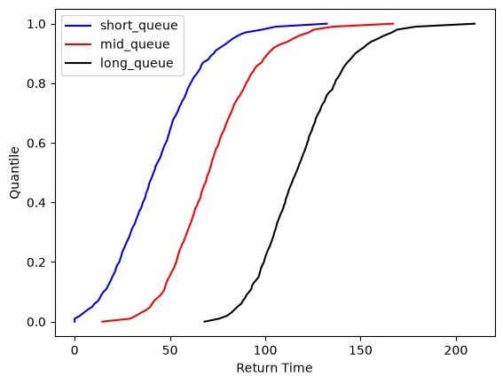
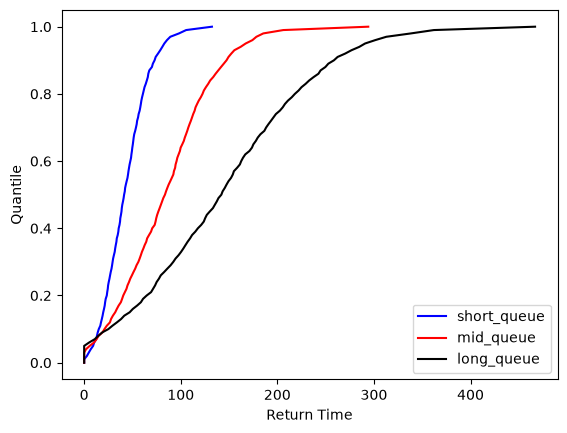

# ski_times_poc

A proof of concept (poc) for estimating ski lift wait times from gate returns data.

A return time is the time between a skier passing through the gates at the bottom of
the mountain and passing through the same gates again after taking the lift and skiing
back down. This project tests whether changes in lift queue time can be measured from
the distribution of those return times. All results so far use simulated data, not real
gate data.

**Result so far:** the method recovers the difference in queue time to within about 7%
when only the queue changes. When skiing behaviour and noise change with the queue, it
overestimates the difference by about 28–43%, so it needs a calibration step before it
can estimate queue times accurately.

---

## Approach

1. Simulate return times for short, mid and long queues (15, 45 and 90 minutes). Each
   return time is a constant queue + lift time, plus a Weibull-distributed ski-down time
   with a minimum, plus normally distributed noise. Totals are clipped at zero.
2. Build the cumulative distribution function (CDF) of return times for each dataset,
   using quantiles from 0 to 1 in steps of 0.01.
3. Take the horizontal distance between each pair of CDFs at every quantile, and
   summarise it with the mean, median, max and min.
4. Compare each summary with the known difference in queue time.

## Results

Each scenario uses 1,000 simulated skiers per queue length. The two notebooks use these
inputs, all in minutes:

| Scenario | Queue | Ski-down scale | Minimum ski-down | Noise SD |
|---|---|---|---|---|
| Simple: all queue lengths | 15 / 45 / 90 | 30 | 10 | 15 |
| Complex: short queue | 15 | 30 | 10 | 15 |
| Complex: mid queue | 45 | 40 | 20 | 45 |
| Complex: long queue | 90 | 50 | 30 | 90 |

Estimated difference in queue time, with percentage error in brackets:

| Comparison | Actual | Simple: mean | Simple: median | Complex: mean | Complex: median |
|---|---|---|---|---|---|
| Short vs mid | 30 | 27.83 (7.2%) | 27.93 (6.9%) | 38.27 (27.6%) | 38.81 (29.4%) |
| Mid vs long | 45 | 46.73 (3.9%) | 46.97 (4.4%) | 63.54 (41.2%) | 64.42 (43.2%) |
| Short vs long | 75 | 74.56 (0.6%) | 74.86 (0.2%) | 101.81 (35.7%) | 103.24 (37.7%) |

| Simple scenario: only the queue changes | Complex scenario: behaviour and noise also change |
|---|---|
|  |  |

- **The approach is viable in the best case.** With only the queue changing, the mean
  and median are within about 7% of the true difference.
- **Mean and median perform similarly,** and neither is consistently better.
- **Max and min are unreliable.** In the simple scenario max has 0.2–8.2% error and min
  has 14–32%. In the complex scenario max has 338–420% error and min has 100%.
- **Return times alone cannot separate queue time from ski-down time.** In the complex
  scenario, slower skiing adds to the measured shift, so the method overestimates the
  queue difference. It still ranks short, mid and long queues correctly.

These figures come from one random seed per dataset, so small differences between
measures may be chance.

Full write-ups, with code and plots:

- [Notebook 1: viability on simple data](docs/ski_times_poc_nb_1.md)
- [Notebook 2: competing behaviour and noise](docs/ski_times_poc_nb_2.md)

### Next steps

- Investigate calibration approaches, and test whether any can reach useful accuracy
  (for example, within 10% of actual delay times).
- Test much smaller samples. Collecting 1,000 returns takes hours, so live queue
  reporting needs the method to work with far less data.

## Quick start

This project uses [`uv`](https://docs.astral.sh/uv/) to manage the Python
toolchain, virtual environment and dependencies. You do **not** need a
system-wide Python 3.11 — `uv` will fetch one for you.

```bash
# 1. Install uv (one-time, if you don't have it):
#    https://docs.astral.sh/uv/getting-started/installation/

# 2. Clone & enter the repo
git clone https://github.com/BenFlint123/ski_times_poc.git
cd ski_times_poc

# 3. Install Python 3.11 (managed by uv) and pin the project to it
uv python install 3.11
uv python pin 3.11

# 4. Create the venv and install the project + dev dependencies
uv venv
uv sync --all-groups

# 5. Install pre-commit hooks
uv run pre-commit install
uv run pre-commit install --hook-type pre-push
```

Verify the install:

```bash
uv run python -c "import lib; print('lib import OK')"
uv run pytest -q
uv run jupyter lab
```

The notebooks generate their own simulated data, so no dataset is needed. Open a
notebook under `notebooks/` and run all cells.

## Reproducing the write-ups

Committed notebooks have their outputs stripped, so `docs/` holds the rendered results.
To regenerate them from a fresh kernel, run this from the repo root:

```bash
uv run jupyter nbconvert --to markdown --execute \
  --ExecutePreprocessor.kernel_name=python3 --output-dir docs \
  notebooks/ski_times_poc_nb_1.ipynb notebooks/ski_times_poc_nb_2.ipynb
```

The data is seeded, so re-running with unchanged code gives the same results.

## Project structure & workflow

```
data/
├── raw/         # dataset exactly as received — never edited in place
├── interim/     # working intermediate outputs
└── processed/   # final, analysis-ready data notebooks actually read from
docs/            # rendered notebook write-ups and their plots
notebooks/       # analysis, numbered in reading order (ski_times_poc_nb_1.ipynb, ...)
lib/             # reusable code shared across notebooks
tests/           # tests for lib/
```

- **`data/`** — all three subfolders are gitignored except a `.gitkeep`
  marker, so the folders exist after a fresh clone but no data is ever
  committed. The current notebooks use simulated data, so these folders are
  empty until real gate data is added.
- **`docs/`** — markdown exports of the notebooks, generated with `nbconvert`.
  Regenerate them rather than editing them by hand.
- **`notebooks/`** — analysis notebooks, numbered so the investigation order is
  visible in the file list. `nbstripout` strips cell outputs automatically
  before each commit, keeping diffs readable. Export to `docs/` before committing
  if you're relying on outputs saved in the notebook.
- **`lib/`** — code reused across notebooks. The simulated data comes from
  `lib/data_generation.py`:
  ```python
  from lib.data_generation import get_dummy_returns_data
  ```
  This works with no `sys.path` setup because `uv sync` installs `lib` in
  editable mode — the same mechanism in VS Code, plain `jupyter lab`,
  scripts, and pytest. After changing code in `lib/`, restart the notebook
  kernel so it picks up the change.
- **`tests/`** — tests for `lib/` code, not the notebooks themselves.

Need to pull in another project of yours that's already packaged and
released (not on PyPI)? No PyPI required — `uv` installs directly from git:
```bash
uv add "pkgname @ git+https://github.com/org/repo.git@vX.Y.Z"
```

## Day-to-day commands

```bash
uv run pytest                     # run tests for lib/ + coverage report
uv run ruff format .              # format
uv run ruff check . --fix         # lint + autofix
uv run pre-commit run --all-files # all commit-stage hooks
uv run jupyter lab                # start notebook server
```

## Contributing

See [CONTRIBUTING.md](CONTRIBUTING.md).

## License

BSD 3-Clause — see [LICENSE](LICENSE).
