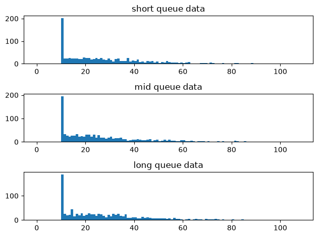
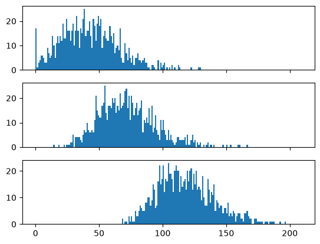
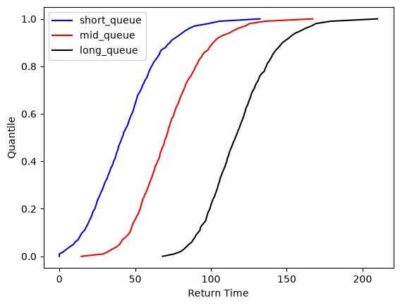

# Ski_times_poc notebook 1

This notebook reads in dummy datasets that are constructed of a baseline queue wait /
lift time, average ski down times (assumed to be Weibull distributed) and normal
noise.

The goal of this notebook is to be able to determine the difference in baseline queue
wait / lift time. Because the dummy data takes this queue wait time as an input, we can
tell whether this approach is successful by comparing the detected difference in wait time
to the wait time assumed in the dataset creation.

Outline of approach is to construct the cumulative distribution function (CDF) for each
input dataset. Then to take the difference between each CDF to determine the average
horizontal difference between distributions.

Goals:
    - To test the viability of the approach.  (this notebook).
    - To test whether mean horizontal distance is an appropriate measure (can test against max, min and median).  (this notebook).
    - To indicate whether a separate calibration step is required to estimate queue time (i.e., does a differing levels of noise or changes in skiing behaviour between runs reduce the accuracy of the queue estimate).  (notebook 2).


```python
import matplotlib.pyplot as plt
import numpy as np
import pandas as pd

from lib.data_generation import get_dummy_returns_data
```

## Test viability of approach on simple data, large sample


```python
# Set input delays
SHORT_QUEUE_TIME = 15
MID_QUEUE_TIME = 45
LONG_QUEUE_TIME = 90
```


```python
# Only difference between datasets is queue time, keep all else the same with large sample
short_queue_data = get_dummy_returns_data(
    1000, SHORT_QUEUE_TIME, 30, 10, 15, random_seed=1
)
mid_queue_data = get_dummy_returns_data(1000, MID_QUEUE_TIME, 30, 10, 15, random_seed=2)
long_queue_data = get_dummy_returns_data(
    1000, LONG_QUEUE_TIME, 30, 10, 15, random_seed=3
)
print(f"Short queue data summary: \n{short_queue_data.describe()}")
print(f"Mid queue data summary: \n{mid_queue_data.describe()}")
print(f"Long queue data summary: \n{long_queue_data.describe()}")
```

    Short queue data summary:
           queue_lift_time  ski_down_time      noise  total_return_time
    count           1000.0         1000.0     1000.0             1000.0
    mean              15.0      27.745979   0.289981           43.08714
    std                0.0      17.208885  14.688239          22.738106
    min               15.0           10.0  -48.61901                0.0
    25%               15.0      13.151771  -9.713855          26.195696
    50%               15.0      23.836957   0.379509          41.351272
    75%               15.0      37.346728   9.719158          57.440127
    max               15.0      98.208529  57.790972         132.290231
    Mid queue data summary:
           queue_lift_time  ski_down_time      noise  total_return_time
    count           1000.0         1000.0     1000.0             1000.0
    mean              45.0      27.035161   0.289981          72.325142
    std                0.0      17.293194  14.688239          22.883754
    min               45.0           10.0  -48.61901            14.5467
    25%               45.0       12.89609  -9.713855           55.84398
    50%               45.0      22.139542   0.379509          70.362667
    75%               45.0      35.182085   9.719158          85.591221
    max               45.0     104.535153  57.790972         167.052459
    Long queue data summary:
           queue_lift_time  ski_down_time      noise  total_return_time
    count           1000.0         1000.0     1000.0             1000.0
    mean              90.0      27.897012   0.289981         118.186993
    std                0.0      17.316967  14.688239          22.285774
    min               90.0           10.0  -48.61901          68.141564
    25%               90.0       13.66006  -9.713855         102.159233
    50%               90.0      23.878366   0.379509         116.087422
    75%               90.0      36.474194   9.719158         131.634972
    max               90.0     108.184358  57.790972         209.847222


```python
# Create histogram for ski down times
sd_fig, (ax1, ax2, ax3) = plt.subplots(3, 1, sharex=True)
short_queue_bins = np.arange(0, short_queue_data["ski_down_time"].max(), 1)
mid_queue_bins = np.arange(0, mid_queue_data["ski_down_time"].max(), 1)
long_queue_bins = np.arange(0, long_queue_data["ski_down_time"].max(), 1)
ax1.hist(short_queue_data["ski_down_time"], bins=short_queue_bins)
ax1.set_title("short queue data")
ax1.tick_params(axis="x", labelbottom=True)
ax2.hist(mid_queue_data["ski_down_time"], bins=mid_queue_bins)
ax2.set_title("mid queue data")
ax2.tick_params(axis="x", labelbottom=True)
ax3.hist(long_queue_data["ski_down_time"], bins=long_queue_bins)
ax3.set_title("long queue data")
sd_fig.tight_layout()
plt.show()
```





Ski down times look reasonable. Large spike at the minimum ski-down time. This
represents competent skiers who ski directly down the run back to the gate immediately.
Distribution of ski down times above this, quite well spread, representing slower skiers
and skiers who visit other runs / do not ski directly back to the original gate.

NB: This is ski down time only, so no rightward shift based on queue time is as expected


```python
# Create histogram of total times including queue time, ski down time and normal noise
tot_fig, (ax4, ax5, ax6) = plt.subplots(3, 1, sharex=True)
short_queue_bins = np.arange(0, short_queue_data["total_return_time"].max(), 1)
mid_queue_bins = np.arange(0, mid_queue_data["total_return_time"].max(), 1)
long_queue_bins = np.arange(0, long_queue_data["total_return_time"].max(), 1)
ax4.hist(short_queue_data["total_return_time"], bins=short_queue_bins)
ax5.hist(mid_queue_data["total_return_time"], bins=mid_queue_bins)
ax6.hist(long_queue_data["total_return_time"], bins=long_queue_bins)
plt.show()
```





Datasets look reasonable. Rightward skewed data with more pronounced rightward skew for
dataset with shorter queues. Difference in queue times causes clear rightward shift of
data. This is good for testing the simple case. We should be able to pick this shift up

## Calculate quantiles and construct cumulative distribution function


```python
def get_quantiles_df(input_df: pd.DataFrame, col_name: str) -> pd.DataFrame:
    input_df = input_df.copy().sort_values(by=col_name, ascending=True)
    quantiles = np.arange(0, 101) / 100
    quantiles_df = (
        input_df[col_name].quantile(quantiles).to_frame().reset_index(names="quantiles")
    )
    return quantiles_df
```


```python
short_queue_quantiles = get_quantiles_df(short_queue_data, "total_return_time")
mid_queue_quantiles = get_quantiles_df(mid_queue_data, "total_return_time")
long_queue_quantiles = get_quantiles_df(long_queue_data, "total_return_time")
plt.plot(
    short_queue_quantiles["total_return_time"],
    short_queue_quantiles["quantiles"],
    color="b",
    label="short_queue",
)
plt.plot(
    mid_queue_quantiles["total_return_time"],
    mid_queue_quantiles["quantiles"],
    color="r",
    label="mid_queue",
)
plt.plot(
    long_queue_quantiles["total_return_time"],
    long_queue_quantiles["quantiles"],
    color="k",
    label="long_queue",
)
plt.legend()
plt.xlabel("Return Time")
plt.ylabel("Quantile")
plt.show()
```





```python
# Merge into one table
quantiles = short_queue_quantiles.merge(
    mid_queue_quantiles, on="quantiles", how="inner", suffixes=("_short", None)
).merge(long_queue_quantiles, on="quantiles", how="inner", suffixes=("_mid", "_long"))
quantiles
```


<div>
<style scoped>
    .dataframe tbody tr th:only-of-type {
        vertical-align: middle;
    }

    .dataframe tbody tr th {
        vertical-align: top;
    }

    .dataframe thead th {
        text-align: right;
    }
</style>
<table border="1" class="dataframe">
  <thead>
    <tr style="text-align: right;">
      <th></th>
      <th>quantiles</th>
      <th>total_return_time_short</th>
      <th>total_return_time_mid</th>
      <th>total_return_time_long</th>
    </tr>
  </thead>
  <tbody>
    <tr>
      <th>0</th>
      <td>0.00</td>
      <td>0.0</td>
      <td>14.5467</td>
      <td>68.141564</td>
    </tr>
    <tr>
      <th>1</th>
      <td>0.01</td>
      <td>0.0</td>
      <td>29.038624</td>
      <td>75.774513</td>
    </tr>
    <tr>
      <th>2</th>
      <td>0.02</td>
      <td>2.820059</td>
      <td>32.274088</td>
      <td>79.964423</td>
    </tr>
    <tr>
      <th>3</th>
      <td>0.03</td>
      <td>4.772494</td>
      <td>34.82631</td>
      <td>82.136489</td>
    </tr>
    <tr>
      <th>4</th>
      <td>0.04</td>
      <td>6.799424</td>
      <td>37.818294</td>
      <td>83.774392</td>
    </tr>
    <tr>
      <th>...</th>
      <td>...</td>
      <td>...</td>
      <td>...</td>
      <td>...</td>
    </tr>
    <tr>
      <th>96</th>
      <td>0.96</td>
      <td>85.709815</td>
      <td>117.849916</td>
      <td>162.286192</td>
    </tr>
    <tr>
      <th>97</th>
      <td>0.97</td>
      <td>89.172956</td>
      <td>122.580802</td>
      <td>166.244871</td>
    </tr>
    <tr>
      <th>98</th>
      <td>0.98</td>
      <td>98.160964</td>
      <td>125.41239</td>
      <td>169.108742</td>
    </tr>
    <tr>
      <th>99</th>
      <td>0.99</td>
      <td>105.563687</td>
      <td>135.610769</td>
      <td>178.884861</td>
    </tr>
    <tr>
      <th>100</th>
      <td>1.00</td>
      <td>132.290231</td>
      <td>167.052459</td>
      <td>209.847222</td>
    </tr>
  </tbody>
</table>
<p>101 rows × 4 columns</p>
</div>


# Results


```python
short_mid_delta_mean = abs(
    (quantiles["total_return_time_short"] - quantiles["total_return_time_mid"]).mean()
)
short_mid_delta_median = abs(
    (quantiles["total_return_time_short"] - quantiles["total_return_time_mid"]).median()
)
short_mid_delta_max = (
    (quantiles["total_return_time_short"] - quantiles["total_return_time_mid"])
    .abs()
    .max()
)
short_mid_delta_min = (
    (quantiles["total_return_time_short"] - quantiles["total_return_time_mid"])
    .abs()
    .min()
)

actual = abs(MID_QUEUE_TIME - SHORT_QUEUE_TIME)
print(f"Actual delta between short and mid queues: {actual} minutes.")
print(
    f"Mean delta between short and mid queues: {round(short_mid_delta_mean, 2)} minutes. Percentage error: {round(abs(actual - short_mid_delta_mean) / actual * 100, 2)}%."
)
print(
    f"Median delta between short and mid queues: {round(short_mid_delta_median, 2)} minutes. Percentage error: {round(abs(actual - short_mid_delta_median) / actual * 100, 2)}%."
)
print(
    f"Max delta between short and mid queues: {round(short_mid_delta_max, 2)} minutes. Percentage error: {round(abs(actual - short_mid_delta_max) / actual * 100, 2)}%."
)
print(
    f"Min delta between short and mid queues: {round(short_mid_delta_min, 2)} minutes. Percentage error: {round(abs(actual - short_mid_delta_min) / actual * 100, 2)}%."
)
```

    Actual delta between short and mid queues: 30 minutes.
    Mean delta between short and mid queues: 29.13 minutes. Percentage error: 2.91%.
    Median delta between short and mid queues: 29.04 minutes. Percentage error: 3.2%.
    Max delta between short and mid queues: 34.76 minutes. Percentage error: 15.87%.
    Min delta between short and mid queues: 14.55 minutes. Percentage error: 51.51%.


```python
mid_long_delta_mean = abs(
    (quantiles["total_return_time_mid"] - quantiles["total_return_time_long"]).mean()
)
mid_long_delta_median = abs(
    (quantiles["total_return_time_mid"] - quantiles["total_return_time_long"]).median()
)
mid_long_delta_max = (
    (quantiles["total_return_time_mid"] - quantiles["total_return_time_long"])
    .abs()
    .max()
)
mid_long_delta_min = (
    (quantiles["total_return_time_mid"] - quantiles["total_return_time_long"])
    .abs()
    .min()
)

actual = abs(LONG_QUEUE_TIME - MID_QUEUE_TIME)
print(f"Actual delta between mid and long queues: {actual} minutes.")
print(
    f"Mean delta between mid and long queues: {round(mid_long_delta_mean, 2)} minutes. Percentage error: {round(abs(actual - mid_long_delta_mean) / actual * 100, 2)}%."
)
print(
    f"Median delta between mid and long queues: {round(mid_long_delta_median, 2)} minutes. Percentage error: {round(abs(actual - mid_long_delta_median) / actual * 100, 2)}%."
)
print(
    f"Max delta between mid and long queues: {round(mid_long_delta_max, 2)} minutes. Percentage error: {round(abs(actual - mid_long_delta_max) / actual * 100, 2)}%."
)
print(
    f"Min delta between mid and long queues: {round(mid_long_delta_min, 2)} minutes. Percentage error: {round(abs(actual - mid_long_delta_min) / actual * 100, 2)}%."
)
```

    Actual delta between mid and long queues: 45 minutes.
    Mean delta between mid and long queues: 45.95 minutes. Percentage error: 2.12%.
    Median delta between mid and long queues: 45.98 minutes. Percentage error: 2.18%.
    Max delta between mid and long queues: 53.59 minutes. Percentage error: 19.1%.
    Min delta between mid and long queues: 42.79 minutes. Percentage error: 4.9%.


```python
short_long_delta_mean = abs(
    (quantiles["total_return_time_short"] - quantiles["total_return_time_long"]).mean()
)
short_long_delta_median = abs(
    (
        quantiles["total_return_time_short"] - quantiles["total_return_time_long"]
    ).median()
)
short_long_delta_max = (
    (quantiles["total_return_time_short"] - quantiles["total_return_time_long"])
    .abs()
    .max()
)
short_long_delta_min = (
    (quantiles["total_return_time_short"] - quantiles["total_return_time_long"])
    .abs()
    .min()
)

actual = abs(LONG_QUEUE_TIME - SHORT_QUEUE_TIME)
print(f"Actual delta between short and long queues: {actual} minutes.")
print(
    f"Mean delta between short and long queues: {round(short_long_delta_mean, 2)} minutes. Percentage error: {round(abs(actual - short_long_delta_mean) / actual * 100, 2)}%."
)
print(
    f"Median delta between short and long queues: {round(short_long_delta_median, 2)} minutes. Percentage error: {round(abs(actual - short_long_delta_median) / actual * 100, 2)}%."
)
print(
    f"Max delta between short and long queues: {round(short_long_delta_max, 2)} minutes. Percentage error: {round(abs(actual - short_long_delta_max) / actual * 100, 2)}%."
)
print(
    f"Min delta between short and long queues: {round(short_long_delta_min, 2)} minutes. Percentage error: {round(abs(actual - short_long_delta_min) / actual * 100, 2)}%."
)
```

    Actual delta between short and long queues: 75 minutes.
    Mean delta between short and long queues: 75.08 minutes. Percentage error: 0.11%.
    Median delta between short and long queues: 74.84 minutes. Percentage error: 0.22%.
    Max delta between short and long queues: 77.56 minutes. Percentage error: 3.41%.
    Min delta between short and long queues: 68.14 minutes. Percentage error: 9.14%.


# Conclusion

OK, so the approach works, it's consistently able to estimate the difference in queue
times between short and long queues when given reasonable best case scenario data (i.e.,
large sample size (1000), consistent normally distributed noise, no competing effects).

Both mean and median differences provide similarly performant methods of calculating the
horizontal distance between cumulative distribution functions. Max and Min generally
perform worse so will be discounted.
