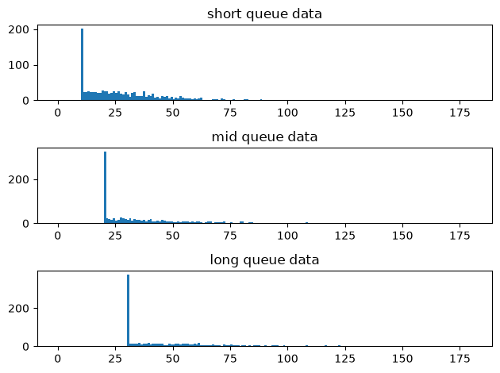
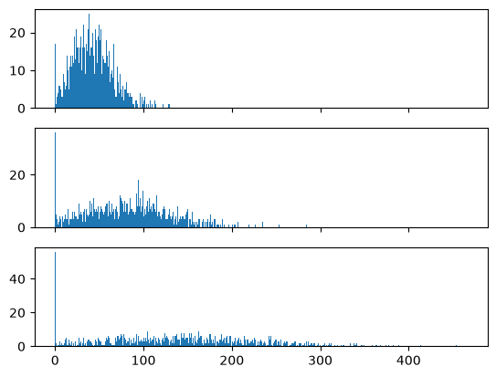
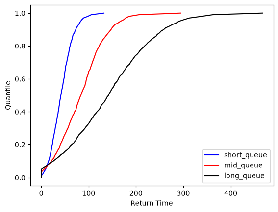

# Ski_times_poc notebook 2

This notebook reads in dummy datasets that are constructed of a baseline queue wait /
lift time, average ski down times (assumed to be Weibull distributed) and normal
noise.

The goal of this notebook is to be able to determine the difference in baseline queue
wait / lift time. Because the dummy data takes this queue wait time as an input, we can
tell whether this approach is successful by comparing the detected difference in wait time
to the wait time assumed in the dataset creation.

Outline of approach is to construct the cumulative distribution function (CDF) for each
input dataset. Then to take the difference between each CDF to determine the average
horizontal difference between distributions.

Goals:
    - To test the viability of the approach.  (see notebook 1).
    - To test whether mean horizontal distance is an appropriate measure (can test against max, min and median).  (see notebook 1).
    - To indicate whether a separate calibration step is required to estimate queue time (i.e., does a differing levels of noise or changes in skiing behaviour between runs reduce the accuracy of the queue estimate).  (this notebook).


```python
import matplotlib.pyplot as plt
import numpy as np
import pandas as pd

from lib.data_generation import get_dummy_returns_data

```

## Test viability of approach on more complex data, large sample


```python
# Set input delays
SHORT_QUEUE_TIME = 15
MID_QUEUE_TIME = 45
LONG_QUEUE_TIME = 90
```


```python
# Add in related effects. Changing queue times will likely change average ski down time, minimum ski down time and amount of noise observed.
short_queue_data = get_dummy_returns_data(1000, SHORT_QUEUE_TIME, 30, 10, 15, random_seed=1)  # short queue time, baseline ski down times, noise in line with queue length
mid_queue_data = get_dummy_returns_data(1000, MID_QUEUE_TIME, 40, 20, 45, random_seed=2)  # medium queue time, increase ski down times assuming fast skiers not desperate to rejoin queue, increase noise to remain in line with queue length
long_queue_data = get_dummy_returns_data(1000, LONG_QUEUE_TIME, 50, 30, 90, random_seed=3)  # long queue time, increase ski down times assuming fast skiers not desperate to rejoin queue, increase noise to remain in line with queue length
print(f"Short queue data: \n{short_queue_data.describe()}")
print(f"Mid queue data: \n{mid_queue_data.describe()}")
print(f"Long queue data: \n{long_queue_data.describe()}")
```

    Short queue data:
           queue_lift_time  ski_down_time      noise  total_return_time
    count           1000.0         1000.0     1000.0             1000.0
    mean              15.0      27.745979   0.289981           43.08714
    std                0.0      17.208885  14.688239          22.738106
    min               15.0           10.0  -48.61901                0.0
    25%               15.0      13.151771  -9.713855          26.195696
    50%               15.0      23.836957   0.379509          41.351272
    75%               15.0      37.346728   9.719158          57.440127
    max               15.0      98.208529  57.790972         132.290231
    Mid queue data:
           queue_lift_time  ski_down_time       noise  total_return_time
    count           1000.0         1000.0      1000.0             1000.0
    mean              45.0      37.631248    0.869943          84.142665
    std                0.0      21.649205   44.064717          48.193145
    min               45.0           20.0  -145.85703                0.0
    25%               45.0           20.0  -29.141564          47.717205
    50%               45.0       29.51939    1.138528          83.639206
    75%               45.0      46.909447   29.157474         114.365675
    max               45.0     139.380204  173.372917         294.119328
    Long queue data:
           queue_lift_time  ski_down_time       noise  total_return_time
    count           1000.0         1000.0      1000.0             1000.0
    mean              90.0      50.014184    1.739885         143.648105
    std                0.0      25.758852   88.129434          87.175719
    min               90.0           30.0 -291.714061                0.0
    25%               90.0           30.0  -58.283127          77.393551
    50%               90.0      39.797276    2.277055         142.032233
    75%               90.0      60.790323   58.314949          202.57622
    max               90.0     180.307263  346.745834         466.821101


```python
# Create histogram for ski down times
sd_fig, (ax1, ax2, ax3) = plt.subplots(3, 1, sharex=True)
short_queue_bins = np.arange(0, short_queue_data["ski_down_time"].max(), 1)
mid_queue_bins = np.arange(0, mid_queue_data["ski_down_time"].max(), 1)
long_queue_bins = np.arange(0, long_queue_data["ski_down_time"].max(), 1)
ax1.hist(short_queue_data["ski_down_time"], bins=short_queue_bins)
ax1.set_title('short queue data')
ax1.tick_params(axis='x', labelbottom=True)
ax2.hist(mid_queue_data["ski_down_time"], bins=mid_queue_bins)
ax2.set_title('mid queue data')
ax2.tick_params(axis='x', labelbottom=True)
ax3.hist(long_queue_data["ski_down_time"], bins=long_queue_bins)
ax3.set_title('long queue data')
sd_fig.tight_layout()
plt.show()
```





Ski down times look reasonable. Large spikes at the minimum ski-down time for each dataset. This
represents competent skiers who ski directly down the run back to the gate immediately.
Distribution of ski down times above this, quite well spread, representing slower skiers
and skiers who visit other runs / do not ski directly back to the original gate. Rightward shift observed due to increase in average and minimum ski down time.

NB: This is ski down time only, so observed rightward shift based on change in average and minimum ski down time only and not due to change in queue length.


```python
# Create histogram of total times including queue time, ski down time and normal noise
tot_fig, (ax4, ax5, ax6) = plt.subplots(3, 1, sharex=True)
short_queue_bins = np.arange(0, short_queue_data["total_return_time"].max(), 1)
mid_queue_bins = np.arange(0, mid_queue_data["total_return_time"].max(), 1)
long_queue_bins = np.arange(0, long_queue_data["total_return_time"].max(), 1)
ax4.hist(short_queue_data["total_return_time"], bins=short_queue_bins)
ax5.hist(mid_queue_data["total_return_time"], bins=mid_queue_bins)
ax6.hist(long_queue_data["total_return_time"], bins=long_queue_bins)
plt.show()
```





Datasets look reasonable. Rightward skewed data with more pronounced rightward skew for
dataset with shorter queues. Difference in queue times causes clear rightward shift of
data. Increased noise expected when queue lines are long due to good skiers choosing other runs and increased likelihood of skiers to stop for food / drink.

## Calculate quantiles and construct cumulative distribution function

Follow same approach as for the simple case to see if method is still functional.


```python
def get_quantiles_df(input_df: pd.DataFrame, col_name: str) -> pd.DataFrame:
    input_df = input_df.copy().sort_values(by=col_name,ascending=True)
    quantiles = np.arange(0, 101) / 100
    quantiles_df = input_df[col_name].quantile(quantiles).to_frame().reset_index(names='quantiles')
    return quantiles_df
```


```python
short_queue_quantiles = get_quantiles_df(short_queue_data, 'total_return_time')
mid_queue_quantiles = get_quantiles_df(mid_queue_data, 'total_return_time')
long_queue_quantiles = get_quantiles_df(long_queue_data, 'total_return_time')
plt.plot(short_queue_quantiles['total_return_time'], short_queue_quantiles['quantiles'], color='b', label='short_queue')
plt.plot(mid_queue_quantiles['total_return_time'], mid_queue_quantiles['quantiles'], color='r', label='mid_queue')
plt.plot(long_queue_quantiles['total_return_time'], long_queue_quantiles['quantiles'], color='k', label='long_queue')
plt.legend()
plt.xlabel('Return Time')
plt.ylabel('Quantile')
plt.show()
```





```python
# Merge into one table
quantiles = short_queue_quantiles.merge(
        mid_queue_quantiles,
        on='quantiles',
        how='inner',
        suffixes=('_short', None)
    ).merge(
        long_queue_quantiles,
        on='quantiles',
        how='inner',
        suffixes=('_mid', '_long')
    )
quantiles
```


<div>
<style scoped>
    .dataframe tbody tr th:only-of-type {
        vertical-align: middle;
    }

    .dataframe tbody tr th {
        vertical-align: top;
    }

    .dataframe thead th {
        text-align: right;
    }
</style>
<table border="1" class="dataframe">
  <thead>
    <tr style="text-align: right;">
      <th></th>
      <th>quantiles</th>
      <th>total_return_time_short</th>
      <th>total_return_time_mid</th>
      <th>total_return_time_long</th>
    </tr>
  </thead>
  <tbody>
    <tr>
      <th>0</th>
      <td>0.00</td>
      <td>0.0</td>
      <td>0.0</td>
      <td>0.0</td>
    </tr>
    <tr>
      <th>1</th>
      <td>0.01</td>
      <td>0.0</td>
      <td>0.0</td>
      <td>0.0</td>
    </tr>
    <tr>
      <th>2</th>
      <td>0.02</td>
      <td>2.820059</td>
      <td>0.0</td>
      <td>0.0</td>
    </tr>
    <tr>
      <th>3</th>
      <td>0.03</td>
      <td>4.772494</td>
      <td>0.0</td>
      <td>0.0</td>
    </tr>
    <tr>
      <th>4</th>
      <td>0.04</td>
      <td>6.799424</td>
      <td>1.906513</td>
      <td>0.0</td>
    </tr>
    <tr>
      <th>...</th>
      <td>...</td>
      <td>...</td>
      <td>...</td>
      <td>...</td>
    </tr>
    <tr>
      <th>96</th>
      <td>0.96</td>
      <td>85.709815</td>
      <td>174.172653</td>
      <td>301.289502</td>
    </tr>
    <tr>
      <th>97</th>
      <td>0.97</td>
      <td>89.172956</td>
      <td>178.312508</td>
      <td>312.818573</td>
    </tr>
    <tr>
      <th>98</th>
      <td>0.98</td>
      <td>98.160964</td>
      <td>185.446652</td>
      <td>338.274688</td>
    </tr>
    <tr>
      <th>99</th>
      <td>0.99</td>
      <td>105.563687</td>
      <td>206.133754</td>
      <td>362.027411</td>
    </tr>
    <tr>
      <th>100</th>
      <td>1.00</td>
      <td>132.290231</td>
      <td>294.119328</td>
      <td>466.821101</td>
    </tr>
  </tbody>
</table>
<p>101 rows × 4 columns</p>
</div>


# Results


```python
short_mid_delta_mean = abs((quantiles['total_return_time_short'] - quantiles['total_return_time_mid']).mean())
short_mid_delta_median = abs((quantiles['total_return_time_short'] - quantiles['total_return_time_mid']).median())
short_mid_delta_max= (quantiles['total_return_time_short'] - quantiles['total_return_time_mid']).abs().max()
short_mid_delta_min= (quantiles['total_return_time_short'] - quantiles['total_return_time_mid']).abs().min()

actual = abs(MID_QUEUE_TIME - SHORT_QUEUE_TIME)
print(f"Actual delta between short and mid queues: {actual} minutes.")
print(f"Mean delta between short and mid queues: {round(short_mid_delta_mean, 2)} minutes. Percentage error: {round(abs(actual - short_mid_delta_mean)/actual*100, 2)}%.")
print(f"Median delta between short and mid queues: {round(short_mid_delta_median, 2)} minutes. Percentage error: {round(abs(actual - short_mid_delta_median)/actual*100,2)}%.")
print(f"Max delta between short and mid queues: {round(short_mid_delta_max, 2)} minutes. Percentage error: {round(abs(actual - short_mid_delta_max)/actual*100,2)}%.")
print(f"Min delta between short and mid queues: {round(short_mid_delta_min, 2)} minutes. Percentage error: {round(abs(actual - short_mid_delta_min)/actual*100,2)}%.")
```

    Actual delta between short and mid queues: 30 minutes.
    Mean delta between short and mid queues: 41.55 minutes. Percentage error: 38.51%.
    Median delta between short and mid queues: 42.29 minutes. Percentage error: 40.96%.
    Max delta between short and mid queues: 161.83 minutes. Percentage error: 439.43%.
    Min delta between short and mid queues: 0.0 minutes. Percentage error: 100.0%.


```python
mid_long_delta_mean = abs((quantiles['total_return_time_mid'] - quantiles['total_return_time_long']).mean())
mid_long_delta_median = abs((quantiles['total_return_time_mid'] - quantiles['total_return_time_long']).median())
mid_long_delta_max= (quantiles['total_return_time_mid'] - quantiles['total_return_time_long']).abs().max()
mid_long_delta_min= (quantiles['total_return_time_mid'] - quantiles['total_return_time_long']).abs().min()

actual = abs(LONG_QUEUE_TIME - MID_QUEUE_TIME)
print(f"Actual delta between mid and long queues: {actual} minutes.")
print(f"Mean delta between mid and long queues: {round(mid_long_delta_mean, 2)} minutes. Percentage error: {round(abs(actual - mid_long_delta_mean)/actual*100, 2)}%.")
print(f"Median delta between mid and long queues: {round(mid_long_delta_median, 2)} minutes. Percentage error: {round(abs(actual - mid_long_delta_median)/actual*100, 2)}%.")
print(f"Max delta between mid and long queues: {round(mid_long_delta_max, 2)} minutes. Percentage error: {round(abs(actual - mid_long_delta_max)/actual*100, 2)}%.")
print(f"Min delta between mid and long queues: {round(mid_long_delta_min, 2)} minutes. Percentage error: {round(abs(actual - mid_long_delta_min)/actual*100, 2)}%.")

```

    Actual delta between mid and long queues: 45 minutes.
    Mean delta between mid and long queues: 59.88 minutes. Percentage error: 33.07%.
    Median delta between mid and long queues: 58.39 minutes. Percentage error: 29.76%.
    Max delta between mid and long queues: 172.7 minutes. Percentage error: 283.78%.
    Min delta between mid and long queues: 0.0 minutes. Percentage error: 100.0%.


```python
short_long_delta_mean = abs((quantiles['total_return_time_short'] - quantiles['total_return_time_long']).mean())
short_long_delta_median = abs((quantiles['total_return_time_short'] - quantiles['total_return_time_long']).median())
short_long_delta_max= (quantiles['total_return_time_short'] - quantiles['total_return_time_long']).abs().max()
short_long_delta_min= (quantiles['total_return_time_short'] - quantiles['total_return_time_long']).abs().min()

actual = abs(LONG_QUEUE_TIME - SHORT_QUEUE_TIME)
print(f"Actual delta between short and long queues: {actual} minutes.")
print(f"Mean delta between short and long queues: {round(short_long_delta_mean, 2)} minutes. Percentage error: {round(abs(actual - short_long_delta_mean)/actual*100, 2)}%.")
print(f"Median delta between short and long queues: {round(short_long_delta_median, 2)} minutes. Percentage error: {round(abs(actual - short_long_delta_median)/actual*100,2)}%.")
print(f"Max delta between short and long queues: {round(short_long_delta_max, 2)} minutes. Percentage error: {round(abs(actual - short_long_delta_max)/actual*100,2)}%.")
print(f"Min delta between short and long queues: {round(short_long_delta_min, 2)} minutes. Percentage error: {round(abs(actual - short_long_delta_min)/actual*100,2)}%.")

```

    Actual delta between short and long queues: 75 minutes.
    Mean delta between short and long queues: 101.43 minutes. Percentage error: 35.24%.
    Median delta between short and long queues: 100.68 minutes. Percentage error: 34.24%.
    Max delta between short and long queues: 334.53 minutes. Percentage error: 346.04%.
    Min delta between short and long queues: 0.0 minutes. Percentage error: 100.0%.


# Conclusion

OK, so the approach continues to be able to distinguish between short and long queues, however accuracy of estimation is impacted by the competing effects of behaviour change and increased noise. specifically, this approach will not be able to tell the difference between changes in queue time and changes in ski down time. This indicates that the proposed approach is appropriate for a queue length differentiation step, however, it suggests that a calibration step is required to accurately estimate queue time.

# Next Steps:

- Investigate approaches to perform calibration. Test whether any calibration approaches provide sufficient accuracy for further use (say, within 10% of actual delay times).
- All of this analysis was performed on large sample sizes. These would only be possible once data gathering has been performed for a few hours and therefore would provide a view of what the queue was like a few hours ago. Need to test on much lower sample sizes to enable live queue length reporting.
